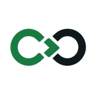

<p align="center">
  
</p>

<p align="center">
  I build tools that help people and coding agents plan, ship and prove their work.
</p>

<p align="center">
  <a href="https://ajiya-dev.pages.dev"></a>
  <a href="https://github.com/AliyuYahaya/Ajiya"></a>
  <a href="https://www.linkedin.com/in/aliyu-yahaya"></a>
  <a href="https://www.npmjs.com/package/@ajiya/cli"></a>
</p>

## Currently building

<table>
  <tr>
    <td width="120" align="center" valign="top">
      <a href="https://github.com/AliyuYahaya/Ajiya">
        <picture>
          <source media="(prefers-color-scheme: dark)" srcset="assets/ajiya-mark-dark.png" />
          
        </picture>
      </a>
    </td>
    <td valign="top">
      <h3><a href="https://github.com/AliyuYahaya/Ajiya">Ajiya</a> &nbsp;·&nbsp; a CLI task manager for coding agents</h3>
      <p>
        Ajiya keeps a project's plan as plain markdown in the repository. Claude Code, Codex and Cursor pick up
        the next task, prove their work with commits and tests, and hand over cleanly between sessions.
        People see progress at a glance in a local dashboard.
      </p>
      <p>
        <code>Go</code> <code>MCP</code> <code>GoReleaser</code> <code>npm</code> <code>Homebrew</code> <code>signed &amp; notarised</code>
      </p>
    </td>
  </tr>
</table>

```sh
npm install -g @ajiya/cli        # or: brew install --cask AliyuYahaya/tap/ajiya
```

## What I work with

<p align="center">
  <br/>
  <br/>
  <br/>
  
</p>

<p align="center">
  <b>Also:</b> API design &amp; integration &nbsp;·&nbsp; CI/CD &nbsp;·&nbsp; server deployment &amp; management
</p>

## Interested in

Developer tools and AI coding agents · web development · retrieval-augmented generation · machine learning · UI/UX

<p align="center">
  
</p>
